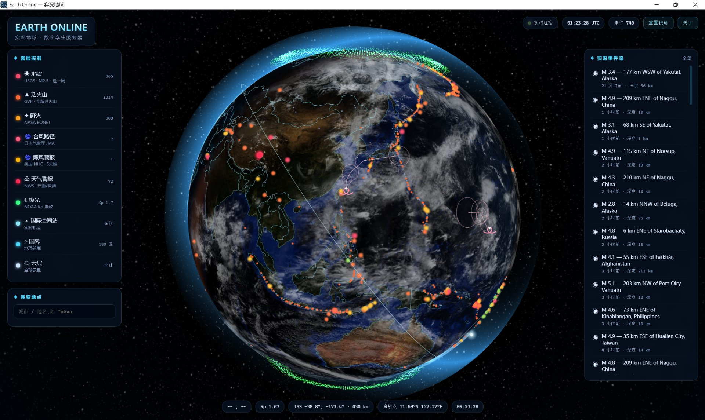

# Earth Online · 实况地球

> 在 3D 地球上叠加真实世界的实时事件——地震、野火、台风、极光、国际空间站，一个窗口看完。
> A real-time 3D digital twin of the planet, overlaying live disaster and space-weather events on a WebGL globe.


**中文** | [English](#english)



---

## 是什么

一个本地运行的实况地球仪表盘。后端是零框架的 Python 标准库 HTTP 服务，负责抓取并缓存八家机构的公开数据；前端是手写 shader 的 three.js 地球。桌面窗口用 pywebview 套 WebView2，也能直接用浏览器打开。

不需要任何 API key，不依赖数据库，断网时自动回退到内置样本数据。

## 功能

**地球渲染**
- 昼夜混合 shader：白天贴图 + 夜灯贴图按真实太阳直射点过渡
- 独立云层球壳、菲涅尔大气辉光、星空背景
- 国界线、经纬网、实时光照终止线
- 鼠标拖拽旋转 / 滚轮缩放 / 射线拾取点击定位

**九个可切换图层**
- 地震 — USGS 全球 M2.5+ 近一周，按震级着色，海啸预警标记
- 火山 — Smithsonian GVP 全新世火山名录 1214 座
- 野火 — NASA EONET 开放火点事件
- 台风 — 日本气象厅，含实测位置与预报路径
- 飓风 — 美国 NHC 五天预报锥 + 路径线
- 天气警报 — NWS 严重/极端级别警报多边形
- 极光 — 由 NOAA 行星 Kp 指数驱动的极光卵形带
- 国际空间站 — 实时位置 + 未来 90 分钟轨迹
- 云层 / 国界 — 静态参考层

**交互**
- 右侧实时事件流，按图层过滤，点击飞向事件并展开详情
- 左侧地点搜索（内置城市库），点击地球任意位置查当地天气
- 底部 HUD：光标经纬度、Kp 指数、ISS 坐标、太阳直射点、UTC 与本地时钟

**数据可靠性**
四级回退：内存 TTL 缓存 → 磁盘缓存 → 内置离线样本 → 显式报错。抓取失败不会让界面空掉。

## 数据源

| 图层 | 来源 | 刷新周期 |
|---|---|---|
| 地震 | [USGS Earthquake Feed](https://earthquake.usgs.gov/earthquakes/feed/v1.0/summary/2.5_week.geojson) | 120 s |
| 野火 | [NASA EONET v3](https://eonet.gsfc.nasa.gov/api/v3/events) | 600 s |
| 台风 | [JMA 台风情报](https://www.jma.go.jp/bosai/typhoon/data/targetTc.json) | 600 s |
| 飓风 | [NOAA NHC GIS](https://www.nhc.noaa.gov/gis/) | 900 s |
| 天气警报 | [NWS Alerts API](https://api.weather.gov/alerts/active) | 180 s |
| 极光 | [NOAA SWPC Kp 指数](https://services.swpc.noaa.gov/products/noaa-planetary-k-index.json) | 300 s |
| 国际空间站 | [wheretheiss.at](https://api.wheretheiss.at/v1/satellites/25544) | 15 s |
| 点选天气 | [Open-Meteo](https://api.open-meteo.com/v1/forecast) | 按需 |

全部为公开接口，无需注册。

## 快速开始

需要 Python 3.10+。先装依赖：

```bash
git clone https://github.com/super964/earth-online.git
cd earth-online
pip install -r requirements.txt
```

**方式一：桌面窗口**（pywebview + WebView2）

```bash
python main.py
```

**方式二：浏览器**（不需要 pywebview 的 GUI 后端）

```bash
python server.py            # 默认 8080
# 或指定端口
python server.py 9000
```

然后打开 `http://127.0.0.1:8080`。

## 使用

- 拖拽旋转地球，滚轮缩放
- 左栏勾选图层开关，`Kp ≥ 5` 时极光带明显增亮
- 点击右侧事件流里任一条 → 视角飞向该点，展开详情面板
- 点击地球表面任意位置 → 顶部查询该坐标天气（Open-Meteo 全球覆盖）

## 项目结构

```
earth-online/
├── main.py              # 桌面入口：起本地服务 + pywebview 建窗
├── server.py            # 静态文件服务 + /api/* 路由（标准库 http.server）
├── api.py               # 八个数据源的抓取、TTL 缓存、离线回退
├── fetch_samples.py     # 重新抓取离线样本到 data/samples/
├── EarthOnline.spec     # PyInstaller onefile 打包配置
├── web/
│   ├── index.html       # HUD 布局
│   ├── globe.js         # three.js 场景、shader、图层绘制
│   ├── app.js           # 数据轮询、事件流、交互逻辑
│   ├── style.css
│   ├── vendor/          # three.min.js（本地引入，无构建步骤）
│   └── img/             # 地球/云层/星空纹理
├── data/
│   ├── countries.geo.json   # 国界 GeoJSON
│   ├── volcanoes.json       # GVP 全新世火山名录
│   └── samples/             # 断网回退样本
└── docs/screenshot.jpg
```

## 打包成单文件 exe

```bash
pip install pyinstaller
pyinstaller EarthOnline.spec --noconfirm
# 产物：dist/地球Online.exe（约 18 MB，内嵌 web/ 与 data/）
```

## 技术栈

- **后端** Python 3.14 标准库 `http.server`，无 Web 框架
- **窗口** pywebview 5（EdgeChromium / WebView2 后端）
- **前端** three.js（WebGL），手写 GLSL 做昼夜混合与大气辉光，无打包工具
- **地理数据** pyshp 解析 NHC 下发的 shapefile（zip 内存直读，不落盘）

## 已知限制

- 台风数据源为日本气象厅，只覆盖西北太平洋；大西洋飓风由 NHC 图层覆盖
- 天气警报仅覆盖美国（NWS 只发美国境内）
- 飓风图层要依次下载并解析多个 shapefile zip，首次加载约 5–15 秒，之后走缓存
- 桌面窗口依赖 WebView2 Runtime（Windows 10/11 通常已预装；缺失则回退到系统默认后端）

## 许可证

MIT © 2026 super964

本项目为独立学习作品，与 earth-live.app 及各数据提供机构无隶属关系。数据版权归各来源机构所有。

---

<a id="english"></a>
# Earth Online — English

> A real-time 3D digital twin of the planet, overlaying live disaster and space-weather events on a WebGL globe.


## What it is

A locally-run earth dashboard. The backend is a zero-framework Python `http.server` that fetches and caches open data from eight agencies; the frontend is a hand-shaded three.js globe. The desktop window wraps it in pywebview + WebView2, but it also runs in a plain browser.

No API keys, no database. When the network fails it falls back to bundled sample data instead of showing an empty screen.

## Features

- **Day/night globe** — custom GLSL blending day texture and city lights by the real subsolar point; separate cloud shell, Fresnel atmosphere glow, starfield
- **Nine toggleable layers** — earthquakes (USGS M2.5+, 7 days), volcanoes (1214 Holocene entries), wildfires (NASA EONET), typhoons (JMA tracks), hurricanes (NHC 5-day forecast cones), severe weather alerts (NWS polygons), aurora oval driven by the NOAA planetary Kp index, ISS live position + 90-minute track, borders and clouds
- **Live event feed** — filter by layer, click to fly to the event and expand details
- **Search & inspect** — built-in city search, click anywhere on the globe for local weather
- **HUD** — cursor lat/lon, Kp index, ISS coordinates, subsolar point, UTC and local clocks
- **Four-stage fallback** — memory TTL cache → disk cache → bundled sample → explicit error

## Quick start

```bash
git clone https://github.com/super964/earth-online.git
cd earth-online
pip install -r requirements.txt

python main.py          # desktop window (pywebview)
# or, browser-only:
python server.py 8080   # then open http://127.0.0.1:8080
```

## Build a single-file exe

```bash
pip install pyinstaller
pyinstaller EarthOnline.spec --noconfirm
# -> dist/地球Online.exe (~18 MB, web/ and data/ embedded)
```

## Tech stack

Python standard-library HTTP server · pywebview 5 (WebView2) · three.js with hand-written GLSL · pyshp for NHC shapefiles · no bundler, no build step.

## License

MIT © 2026 super964. Independent learning project — not affiliated with earth-live.app or any data provider. Data copyright belongs to the respective agencies.
